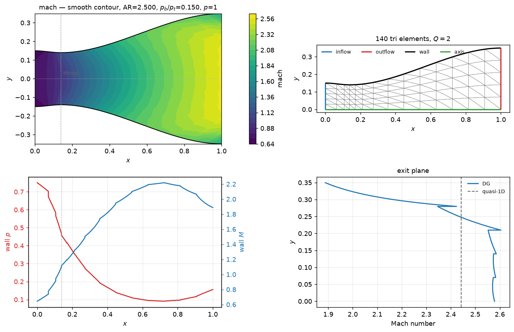

# 2D discontinuous Galerkin nozzle solver

[](https://github.com/mrodrig6/2D_nozzle/actions/workflows/tests.yml) [](https://github.com/mrodrig6/2D_nozzle/actions/workflows/lint.yml) [](https://github.com/mrodrig6/2D_nozzle/actions/workflows/format.yml) [](https://github.com/mrodrig6/2D_nozzle/actions/workflows/spelling.yml) [](LICENSE)

This Python program computes the steady flow of a gas through a nozzle: the duct that speeds gas up to supersonic speed in a rocket or jet engine. Students in the ENGN1700 course at Brown University use it to design nozzles: they change the wall shape or the back pressure and see how thrust and the exit conditions respond.



- Wall shapes: bell, smooth, conical, method-of-characteristics, Bézier and analytic contours.
- Discretisation: nodal discontinuous Galerkin on triangles or quadrilaterals, at several polynomial orders.
- Results: thrust, mass flow and exit conditions, compared with quasi-one-dimensional theory.
- Studies: parameter sweeps, order-of-accuracy checks, exact adjoint sensitivities, and shape optimisation.
- Flow outside the nozzle: lip waves and idealised jet cells from the converged exit state.

To add your own contour or numerical component, see [extending the solver](docs/api/extending.md).

## Install

Requires Python **3.10 or newer**. NumPy is installed automatically; Numba, JAX, Matplotlib and SciPy are optional.

```bash
python -m pip install -e ".[all]"
```

For isolated environments, platform notes and developer tools, see the [installation guide](docs/getting-started/installation.md).

## Quick start

The commands and the Python snippet below were run in this repository's development environment. Their output is not reproduced here.

```bash
# Check installed dependencies and backends.
./nozzle.sh check
# Inspect a wall before solving it.
./nozzle.sh geometry contour=smooth
# Solve a shock-free design point and save an overview.
./nozzle.sh run cases/design.json figure=result.png
# Sweep area ratio and save the numerical table.
./nozzle.sh sweep area_ratio 2.0 4.0 5 contour=smooth order=1 refine=1 csv=sweep.csv
# Compare adjoint gradients with finite differences.
./nozzle.sh example sensitivity
```

```python
from src import performance, solve_nozzle

result = solve_nozzle(contour="smooth", area_ratio=2.5, order=1, verbose=False)
assert result.converged, result.message
print(performance(result).summary())
```

The command line and the Python API are two entry points to the same solver. The walkthrough, with output and how to read it, is in the [quick start](docs/getting-started/quick-start.md); the Python API is in [library usage](docs/api/package.md).

## Testing

From a fresh checkout, after the install step above:

```bash
python -m pytest
```

This runs every test, including the slow full solves. For the fast subset, use `python -m pytest --fast`. The suite stores no baseline or golden files, so no command regenerates or overwrites reference data, and there is no regression mode. For what the tests check and how to run a subset, see the [test-suite page](docs/validation/tests.md).

## Documentation

The documentation index is [docs/README.md](docs/README.md). It is in-repo only; no hosted site is published.

## Citation

No paper describes this code and no citation file exists yet. The methods are referenced in the [bibliography](docs/reference/bibliography.md).

## License

[MIT](LICENSE). Copyright (c) 2026 Mauro Rodriguez.
