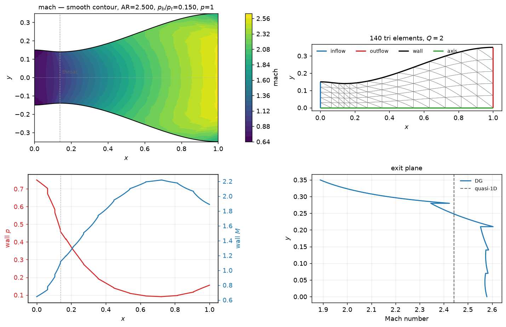

# 2D DG nozzle solver

[](https://github.com/mrodrig6/2D_nozzle/actions/workflows/tests.yml) [](https://github.com/mrodrig6/2D_nozzle/actions/workflows/docs.yml) [](https://github.com/mrodrig6/2D_nozzle/actions/workflows/lint.yml) [](https://github.com/mrodrig6/2D_nozzle/actions/workflows/format.yml) [](https://github.com/mrodrig6/2D_nozzle/actions/workflows/spelling.yml) [](LICENSE)

This Python solver computes steady compressible Euler flow through a planar nozzle. Use it for nozzle design studies: change the wall shape, compare operating points, and measure how thrust responds.



- Solve on triangles or quadrilaterals with nodal discontinuous Galerkin discretization.
- Compare thrust, mass flow and exit conditions with quasi-1D theory.
- Sweep geometry and back pressure, compute adjoint gradients, and optimize shapes.
- Evaluate external lip waves and idealized jet cells from the converged exit state.

Add custom geometry or numerical components through the [documented extension points](docs/api/extending.md).

## Install

From this checkout with Python **3.10 or newer**:

```bash
python -m pip install -e ".[all]"
```

See [installation](docs/getting-started/installation.md) for isolated environments, developer tools and documentation extras.

## Quick start

```bash
# Check installed dependencies and backends.
./dg2d.sh check
# Inspect a wall before solving it.
./dg2d.sh geometry contour=smooth
# Solve a shock-free operating point and save an overview.
./dg2d.sh solve @design figure=result.png
# Sweep area ratio and save the numerical table.
./dg2d.sh sweep area_ratio 2.0 4.0 5 contour=smooth order=1 refine=1 csv=sweep.csv
# Compare adjoint gradients with finite differences.
./dg2d.sh run sensitivity
```

```python
from src import performance, solve_nozzle

result = solve_nozzle(contour="smooth", area_ratio=2.5, order=1, verbose=False)
assert result.converged, result.message
print(performance(result).summary())
```

See the [complete quick start](docs/getting-started/quick-start.md) for captured output and its interpretation.

## Documentation

| Section | Pages |
|---|---|
| Getting started | [Installation](docs/getting-started/installation.md) · [Quick start](docs/getting-started/quick-start.md) · [Examples](docs/getting-started/examples.md) |
| Running | [Command line](docs/running/command-line.md) · [Configuration](docs/running/configuration.md) · [Solving a case](docs/running/solving.md) · [Reading results](docs/running/output.md) · [Parameter sweeps](docs/running/sweeps.md) · [Sensitivity analysis](docs/running/sensitivity.md) · [Shape optimization](docs/running/optimization.md) · [Troubleshooting](docs/running/troubleshooting.md) · [Nozzle contours](docs/running/contours.md) · [Postprocessing](docs/running/postprocessing.md) · [External flow](docs/running/external-flow.md) · [Nozzle design lab](docs/running/lab-guide.md) |
| Python API | [Library usage](docs/api/package.md) · [Extending the solver](docs/api/extending.md) |
| Background / Model | [Problem and assumptions](docs/model/problem.md) · [Parameters](docs/model/parameters.md) · [Units and reference scales](docs/model/units.md) |
| Method | [Spatial discretization](docs/method/discretization.md) · [Numerical fluxes](docs/method/fluxes.md) · [Boundary conditions](docs/method/boundary-conditions.md) · [Backends and performance](docs/method/backends.md) · [Time stepping and convergence](docs/method/time-stepping.md) · [Limiters](docs/method/limiters.md) |
| Theory | [Euler equations](docs/theory/euler.md) · [Discrete adjoint](docs/theory/adjoint.md) · [Quasi-one-dimensional nozzle flow](docs/theory/nozzle-flow.md) · [External waves](docs/theory/external-waves.md) |
| Validation | [Test-suite claims](docs/validation/tests.md) · [Gradient comparisons](docs/validation/gradients.md) · [Quasi-1D and conservation comparisons](docs/validation/quasi-one-dimensional.md) · [Accuracy and curved geometry](docs/validation/accuracy.md) · [Reference-scale invariance](docs/validation/scaling.md) |
| Reference | [Compatibility](docs/reference/compatibility.md) · [Code map](docs/reference/code-map.md) · [Repository map](docs/reference/repository.md) · [Continuous integration](docs/reference/ci.md) · [Figures](docs/reference/figures.md) · [Bibliography](docs/reference/bibliography.md) |

Written for ENGN1700 — High Reynolds Number Flows at Brown University by Mauro Rodriguez. For attribution and scientific references, see the [bibliography](docs/reference/bibliography.md); no formal project citation is specified.

## License

[MIT](LICENSE). Copyright © 2026 Mauro Rodriguez.
