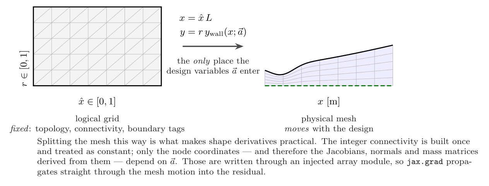
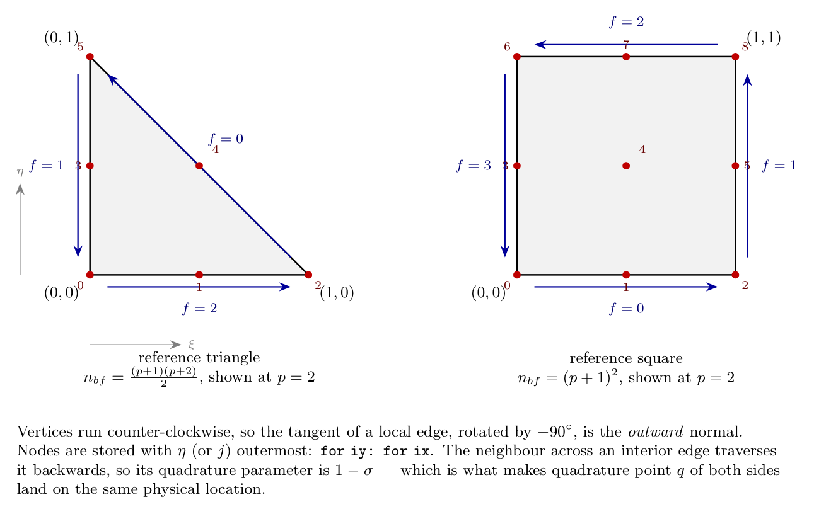
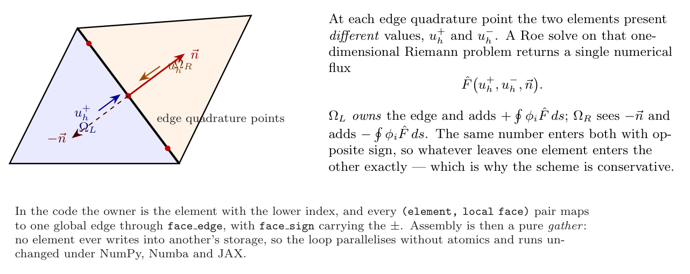

# Spatial discretization

The spatial scheme turns the Euler equations into a residual on each cell or element.

## Discretisation

### Mesh



*The mesh is built as a fixed logical grid plus a design-dependent map. Only
the map depends on $\mathbf{a}$, which is what makes shape derivatives
tractable.*

A structured $n_x \times n_r$ grid of cells is laid out in logical coordinates
$(\hat{x}, r) \in [0,1]^2$ and mapped to the nozzle by

```math
x = \hat{x} L, \qquad y = r\, y_{\mathrm{wall}}(x; \mathbf{a}).
```

Each cell becomes one quadrilateral or two triangles. Refinement level
$\mathrm{ref}$ subdivides each cell $2^{\mathrm{ref}}$ ways per direction, so
the element count is $n_x n_r 4^{\mathrm{ref}}$ (doubled for triangles).

Axial nodes may be clustered toward the throat, where the solution varies
fastest. The base distribution is generated from a target spacing

```math
h(\hat{x}) = 1 + (\sigma - 1)
  \left(1 - e^{-\left((\hat{x} - x_{\mathrm{th}})/w\right)^{2}}\right),
```

integrated and inverted, with $\sigma$ the far-field-to-throat spacing ratio.
Refinement then subdivides that base distribution linearly, so the node set at
one refinement level is a subset of the next.

### Reference elements



*Reference elements, Lagrange node ordering and local edge numbering.*

The solution is expanded in a nodal Lagrange basis of order $p$ on each element,

```math
\mathbf{U}_h(\mathbf{x})\big|_{\Omega_e}
= \sum_{i=1}^{n_{bf}} \mathbf{U}_{e,i}\, \phi_i(\xi, \eta),
\qquad
n_{bf} =
\begin{cases}
  \tfrac{1}{2}(p+1)(p+2) & \text{triangle},\\
  (p+1)^{2}              & \text{quadrilateral}.
\end{cases}
```

The element geometry uses an independent Lagrange basis of order $Q$, so $Q = 1$
gives straight-sided elements and $Q = 2$ a quadratic (curved) wall. The
mapping from reference to physical coordinates and its Jacobian are

```math
\mathbf{x}(\xi,\eta) = \sum_{n} \mathbf{x}_n\, \psi_n(\xi,\eta),
\qquad
\mathbf{J} = \frac{\partial(x,y)}{\partial(\xi,\eta)},
\qquad
\nabla_{\mathbf{x}}\phi_i = \mathbf{J}^{-T}\nabla_{(\xi,\eta)}\phi_i .
```

### Weak form

Multiplying the Euler equations by a test function $\phi_i$, integrating over an
element and applying the divergence theorem gives the discrete statement

```math
\int_{\Omega_e} \phi_i \frac{\partial \mathbf{U}_h}{\partial t}\,\mathrm{d}\Omega
=
\int_{\Omega_e} \left(\frac{\partial \phi_i}{\partial x}\mathbf{F}
  + \frac{\partial \phi_i}{\partial y}\mathbf{G}\right)\mathrm{d}\Omega
- \oint_{\partial \Omega_e} \phi_i\,
  \hat{\mathbf{F}}\bigl(\mathbf{U}_h^{+}, \mathbf{U}_h^{-}, \mathbf{n}\bigr)\,\mathrm{d}s
```

for every basis function $i$ and every element $e$. Writing the right-hand side
as $-\mathbf{R}_e$ leaves the semi-discrete system

```math
\mathbf{M}_e\, \dot{\mathbf{U}}_e = -\mathbf{R}_e(\mathbf{U}),
\qquad
(\mathbf{M}_e)_{ij} = \int_{\Omega_e} \phi_i \phi_j\,\mathrm{d}\Omega .
```

The mass matrix is block diagonal — an element couples to itself only — so
$\mathbf{M}^{-1}$ is applied as $n_{elem}$ independent
$n_{bf} \times n_{bf}$ solves.



*Elements communicate only through the numerical flux on their shared edge. The
same value enters both with opposite sign, which is what makes the scheme
conservative.*

### Quadrature

Volume integrals use symmetric positive-weight rules on the triangle (a
Duffy-collapsed Gauss–Jacobi rule for degree $\ge 3$) and tensor-product
Gauss–Legendre on the quadrilateral; edge integrals use Gauss–Legendre on
$[0,1]$. The degrees are

```math
d_{\mathrm{vol}} = 2p + 1 + 2(Q-1),
\qquad
d_{\mathrm{edge}} = 2p + Q .
```

> **Positive weights are not optional.** The Dunavant degree-3 rule used by the
> original code has a negative first weight, $-0.28125$. A negative weight can
> destroy the positive definiteness of $\mathbf{M}_e$ and lets the entropy-error
> integral — a sum of squares — go negative. Every rule here has strictly
> positive weights, checked against exact monomial integrals in the test suite.
