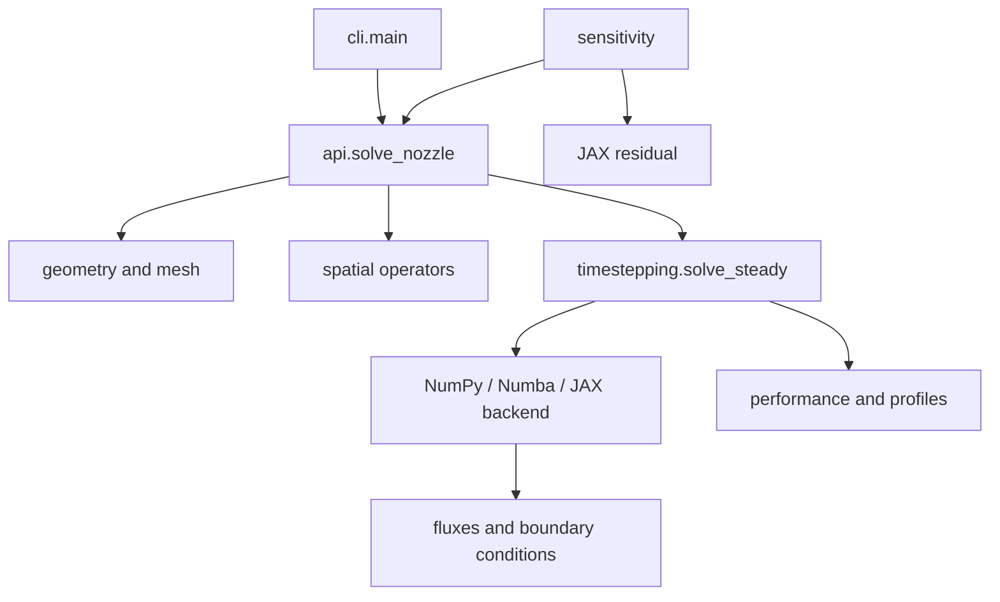

# Code map

This map lists module responsibilities and entry points. Read the diagram as the direction of a normal solve.

## The layers

| | layer | what it owns |
|---|---|---|
| 1 | `config.py` | the stagnation state, the gas, the mesh resolution, the solver options — and the non-dimensionalisation, documented in one place |
| 2 | `reference/` | the reference element: Lagrange bases on the unit triangle and square, and the quadrature that integrates them |
| 3 | `geometry/` | the nozzle contour, and the mesh built inside it |
| 4 | `physics/` | the equations. Pure functions of states and normals, plus the reduced quasi-1D theory |
| 5 | `spatial/` | the right-hand side: DG operators, the residual, the limiter |
| 6 | `timestepping/` | how big a step to take, where the march starts, and the march |
| 7 | `backends/` | *how* the residual gets evaluated — NumPy, Numba or JAX |
| 8 | `post/`, `external/`, `api.py`, `cli.py`, `sweep.py`, `sensitivity.py` | the drivers: what a user actually calls |

Layer 2 is the one a finite-volume code does not have. A cell-centred
finite-volume scheme carries one value per cell, so its "basis" is implicit;
discontinuous Galerkin carries a polynomial per element, and *which*
polynomial is a choice that has to be written down before any mesh exists.
Everything in `reference/` is a table on the unit triangle or square. At
`p = 0` those tables collapse to a single constant and the scheme *is*
first-order finite volume — which is why the airfoil code needs no equivalent.

Layers 4 and 5 are the split worth understanding. `physics/` answers *what is
the flux through this face*, and has never heard of a mesh. `spatial/` answers
*what is $M\,dU/dt$ in this element*, and does the mesh and basis bookkeeping
that turns the first answer into the second. Changing a flux touches only
`physics/`; changing the discretisation touches only `spatial/`.

Layer 8 is not a subpackage, because its members have nothing in common except
being entry points. `external/` is there because, as its own docstring says,
it is post-processing that reads a converged exit state and is never part of a
solve; it keeps its own subpackage rather than folding into `post/` because it
is a self-contained physical model — oblique shocks, Prandtl–Meyer fans and
their reflections — rather than a reduction of the solution.

## The tree

Module-level imports only; `->` reads "imports". Deferred (function-level)
imports are listed [separately](code-map.md#the-deferred-imports), because they are what
keeps this tree acyclic.

```
config                   -> (nothing)

reference/elements       -> (nothing)
reference/quadrature     -> (nothing)

geometry/contour         -> (nothing)
geometry/mesh            -> geometry/contour, reference

physics/thermo           -> (nothing)
physics/fluxes           -> physics/thermo
physics/boundary         -> physics/thermo
physics/quasi1d          -> config, geometry/contour

spatial/operators        -> geometry/mesh, reference
spatial/assembly         -> config, geometry/mesh, physics, spatial/operators
spatial/limiter          -> config, spatial/operators

timestepping/step        -> config, physics, spatial/operators
timestepping/initialize  -> config, geometry/contour, physics/quasi1d,
                            spatial/operators
timestepping/march       -> config, geometry/contour, spatial,
                            spatial/operators, timestepping/{initialize,step}

backends/_numba_kernels  -> (nothing)
backends/base            -> config, spatial/operators
backends/numpy_backend   -> backends/base, spatial, timestepping
backends/numba_backend   -> backends/base, backends/_numba_kernels, spatial,
                            timestepping
backends/jax_backend     -> backends/base, spatial, timestepping
backends/__init__        -> backends/base, backends/numpy_backend, config,
                            spatial/operators

post/postprocess         -> config, geometry/mesh, physics, physics/quasi1d,
                            spatial/operators, timestepping/march
api                      -> config, geometry/{contour,mesh}, physics,
                            physics/quasi1d, spatial/operators, timestepping,
                            timestepping/march
sweep                    -> api, config, geometry/contour, physics/quasi1d,
                            post/postprocess
post/plotting            -> geometry/{contour,mesh}, physics/quasi1d,
                            post/postprocess, sweep, timestepping/march
external/waves           -> (nothing)
external/plume           -> external/waves, post/postprocess
external/jet             -> external/plume, external/waves
external/plotting        -> external/{jet,plume}, physics/quasi1d,
                            post/plotting
sensitivity              -> api, config, geometry/{contour,mesh}, physics,
                            spatial, spatial/operators, timestepping,
                            timestepping/march
cli                      -> config
__init__                 -> api, config, geometry/{contour,mesh},
                            physics/quasi1d, post/postprocess, sweep,
                            timestepping/march
__main__                 -> cli
```

`backends/_numba_kernels.py` importing nothing is the one deliberate
duplication in the tree: Numba's `nopython` mode cannot call the `xp`-injected
physics, so those kernels restate it. `tests/test_backends.py` is what holds
the two copies in step — see [`docs/performance.md`](../method/backends.md).

## Within each subpackage

Each `__init__.py` re-exports its subpackage's public names, so
`from src.physics import roe_flux` works without knowing that it lives in
`physics/fluxes.py`. Import from the subpackage when you only want the name,
and from the module when the file is the point.

```
reference/     elements.py     Lagrange bases on the unit triangle and square,
                               node placement, local edge numbering
               quadrature.py   Gauss–Legendre and collapsed Gauss–Jacobi
                               rules, all with strictly positive weights

geometry/      contour.py      the nozzle wall families and their design
                               parameters
               mesh.py         topology, node coordinates, boundary tags,
                               triangles or quads

physics/       thermo.py       primitive variables, the ideal-gas relations,
                               the Euler flux itself
               fluxes.py       roe, hllc, ausmup
               boundary.py     the inviscid wall, and the characteristic
                               inflow and outflow
               quasi1d.py      the exact one-dimensional theory: area–Mach,
                               normal shocks, operating regimes

spatial/       operators.py    metrics, mass matrices, normals — everything a
                               residual evaluation needs, precomputed once
               assembly.py     the volume and face terms, and M⁻¹
               limiter.py      positivity (Zhang–Shu) and slope (superbee)

timestepping/  step.py         the measured stability limits, the local time
                               step, the residual scale
               initialize.py   uniform and quasi-1D starts, order change
               march.py        the pseudo-time march, convergence, stall

backends/      base.py            the Backend interface and the integrators
               numpy_backend.py   vectorised NumPy: the reference
               numba_backend.py   compiled, parallel: the default
               jax_backend.py     traceable: for sensitivity, not speed
               _numba_kernels.py  the nopython restatement of the physics

post/          postprocess.py  thrust, entropy error, line-outs, fields
               plotting.py     matplotlib figures (optional dependency)

external/      waves.py        oblique shocks and Prandtl–Meyer fans
               plume.py        the first wave at the lip
               jet.py          that wave marched through its reflections
               plotting.py     figures for the above
```

The stage combinations of each time scheme live in `backends/base.py`, not in
`timestepping/`, so that all three backends share one definition of each
scheme rather than three that have to be kept in step.

`post/` re-exports `postprocess` but not `plotting`, because matplotlib is an
optional dependency and importing the package should not require it.
`src.plotting` is a lazy attribute on the top-level package for the same
reason.

## The deferred imports

Several imports sit inside functions rather than at module top level, for two
reasons: to break a cycle, or to keep an optional dependency optional. These
are the ones that matter.

| in | imports | why |
|---|---|---|
| `timestepping/march.py`, `cli.py` | `backends` | importing a backend imports Numba or JAX. Deferring it means `import src` costs neither, and `dg2d.sh --help` does not pay for a JIT compiler. It is also what keeps the march below the backends in the layer order. |
| `config.py` | `reference` | the default quadrature degree depends on the element and the order, which only `reference/elements.py` knows. Layer 1 cannot eagerly reach layer 2. |
| `post/postprocess.py`, `post/plotting.py`, `timestepping/initialize.py` | `reference` | node coordinates for sampling and for plotting, needed in a handful of functions rather than throughout. |
| `sensitivity.py` | `backends.jax_backend` | the adjoint needs JAX; nothing else does. |
| `src/__init__.py` | `post.plotting`, `sensitivity` | matplotlib and JAX are optional, so both are lazy attributes. |

`cli.py` defers nearly all of its imports for the first reason.

## Checking this page

A dependency tree in prose rots. These two commands print the current truth,
and are what the tables above were generated from.

The tree, split into eager and deferred:

```bash
python - <<'PY'
import ast, pathlib
root = pathlib.Path("src")
for p in sorted(root.rglob("*.py")):
    rel = p.relative_to(root); pkg = list(rel.parts[:-1])
    name = str(rel.with_suffix("")).replace("/", ".").replace(".__init__", "")
    tree = ast.parse(p.read_text(encoding="utf-8")); top = {id(n) for n in tree.body}
    eager, lazy = set(), set()
    for parent in ast.walk(tree):
        for n in ast.iter_child_nodes(parent):
            if isinstance(n, ast.ImportFrom) and n.level:
                base = pkg[: len(pkg) - (n.level - 1)] if n.level > 1 else pkg
                mods = ([".".join(base + (n.module or "").split("."))] if n.module
                        else [".".join(base + [a.name]) for a in n.names])
                (eager if id(n) in top else lazy).update(m for m in mods if m and m != name)
    print(f"{name:<24} eager: {', '.join(sorted(eager)) or '-'}")
    if lazy - eager:
        print(f"{'':<24} lazy : {', '.join(sorted(lazy - eager))}")
PY
```

And the layer invariant — that no module eagerly imports one below it. On a
tree that holds, it prints nothing:

```bash
python - <<'PY'
import ast, pathlib
LAYER = {"config": 1, "reference": 2, "geometry": 3, "physics": 4,
         "spatial": 5, "timestepping": 6, "backends": 7}
def layer(m):
    return LAYER.get(m.split(".")[0], 8)
root = pathlib.Path("src")
for p in sorted(root.rglob("*.py")):
    rel = p.relative_to(root); pkg = list(rel.parts[:-1])
    name = str(rel.with_suffix("")).replace("/", ".").replace(".__init__", "")
    for n in ast.parse(p.read_text(encoding="utf-8")).body:
        if isinstance(n, ast.ImportFrom) and n.level:
            base = pkg[: len(pkg) - (n.level - 1)] if n.level > 1 else pkg
            mods = ([".".join(base + (n.module or "").split("."))] if n.module
                    else [".".join(base + [a.name]) for a in n.names])
            for m in mods:
                if m and layer(m) > layer(name):
                    print(f"{name} (L{layer(name)}) -> {m} (L{layer(m)})")
PY
```

## Module reference

| Module | Responsibility | Main functions / classes |
|---|---|---|



