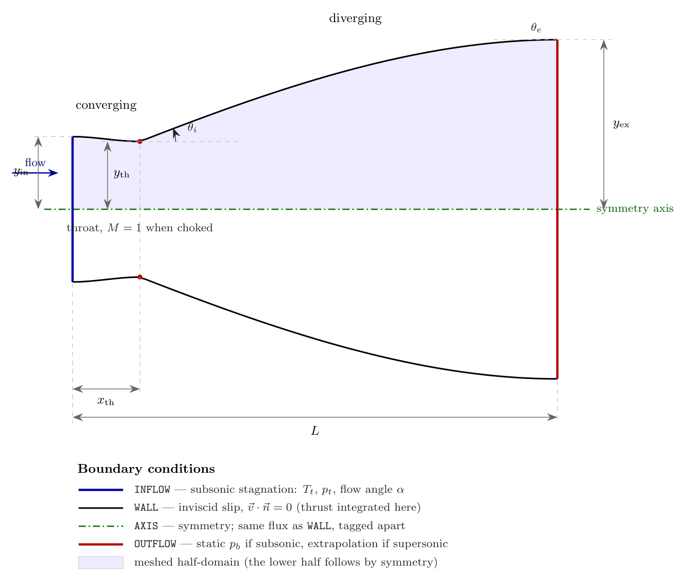

# Nozzle contours

Choose a nozzle wall family before building the mesh. This page defines the implemented geometry and identifies fixed or prescribed-angle families.

## Nozzle geometry



*Nozzle geometry, design variables and boundary conditions. The shaded region
is the half-domain that is actually meshed. The wall shown is the `'bell'`
contour at $\mathrm{AR} = 2.5019$, $x_{\mathrm{th}} = 0.1388$.*

### Design variables

The wall half-height $y_{\mathrm{wall}}(x; \mathbf{a})$ is controlled by

```math
\mathbf{a} = \bigl(\mathrm{AR},\; x_{\mathrm{th}},\; y_{\mathrm{th}},\;
              y_{\mathrm{in}},\; L,\; \theta_i,\; \theta_e,\; w_1,\; w_2\bigr),
```

every one of which is differentiable ([Design sensitivities](../theory/adjoint.md#design-sensitivities)).

| Symbol | Code name | Meaning |
|---|---|---|
| $\mathrm{AR}$ | `area_ratio` | exit-to-throat area ratio |
| $x_{\mathrm{th}}$ | `throat_x` | throat location as a fraction of $L$ |
| $y_{\mathrm{th}}$ | `throat_half_height` | throat half-height; scales the nozzle |
| $y_{\mathrm{in}}$ | `inlet_half_height` | inlet half-height; must exceed $y_{\mathrm{th}}$ |
| $L$ | `length` | axial length |
| $\theta_i$ | `theta_initial_deg` | wall angle just downstream of the throat |
| $\theta_e$ | `theta_exit_deg` | wall angle at the exit plane |
| $w_1, w_2$ | `bezier_w1` / `bezier_w2` | Bézier shape weights |

### Converging section

For $x \le x_{\mathrm{th}} L$, with $s = x/(x_{\mathrm{th}} L) \in [0,1]$, the
wall is a cubic Hermite with zero slope at both ends,

```math
y_{\mathrm{wall}}(s) = h_{00}(s)\, y_{\mathrm{in}} + h_{01}(s)\, y_{\mathrm{th}},
\qquad
\begin{aligned}
  h_{00}(s) &= 2s^{3} - 3s^{2} + 1, \\
  h_{01}(s) &= -2s^{3} + 3s^{2}.
\end{aligned}
```

Because $y'(x_{\mathrm{th}}^{-}) = 0$, the point $x_{\mathrm{th}}$ really is a
stationary point of the wall, so "throat" and "$x_{\mathrm{th}}$" agree.

### Diverging section

For $x > x_{\mathrm{th}} L$, with
$s = (x - x_{\mathrm{th}}L)/(L - x_{\mathrm{th}}L)$ and
$y_{\mathrm{ex}} = \mathrm{AR}\,y_{\mathrm{th}}$, six named families are available.

**`'conical'` — straight wall.**

```math
y_{\mathrm{wall}} = y_{\mathrm{th}} + (y_{\mathrm{ex}} - y_{\mathrm{th}})\, s .
```

**`'bell'` and `'moc'` — prescribed wall angles.** A cubic Hermite with slopes
$\tan\theta_i$ and $\tan\theta_e$ (converted to the $s$ variable through
$\mathrm{d}x/\mathrm{d}s$):

```math
y_{\mathrm{wall}} = h_{00} y_{\mathrm{th}} + h_{10} m_i
                  + h_{01} y_{\mathrm{ex}} + h_{11} m_e ,
\qquad
\begin{aligned}
  h_{10}(s) &= s^{3} - 2s^{2} + s, \\
  h_{11}(s) &= s^{3} - s^{2},
\end{aligned}
```

with $m_i = \tan\theta_i \cdot \mathrm{d}x/\mathrm{d}s$ and similarly for
$m_e$. `'moc'` fixes $\theta_i = 30^{\circ}$, $\theta_e = 0$, the classical Rao
values.

> **A slope discontinuity, on purpose.** With $\theta_i > 0$ the wall slope
> jumps from $0$ to $\tan\theta_i$ at the throat. That sharp corner is the
> idealisation used in minimum-length nozzle design — it launches a centred
> Prandtl–Meyer expansion fan — and it is *not* a defect. It does, however, put
> a singularity into the exact solution, which caps the achievable order of
> accuracy. [Verification](../validation/accuracy.md#order-of-accuracy) quantifies this. Use `'smooth'`
> or `'analytic'` for convergence studies.

**`'smooth'` — $C^1$ throat.** The `'bell'` form with $\theta_i = 0$, so the
wall slope is continuous across the throat and the exact solution is smooth.

**`'bezier'` — two shape weights.** A cubic Bézier in $s$ with interior control
values $c_k = y_{\mathrm{th}} + w_k (y_{\mathrm{ex}} - y_{\mathrm{th}})$:

```math
y_{\mathrm{wall}} = (1-s)^{3} y_{\mathrm{th}} + 3(1-s)^{2} s\, c_1
  + 3(1-s) s^{2} c_2 + s^{3} y_{\mathrm{ex}} .
```

$(w_1, w_2) = (\tfrac13, \tfrac23)$ reproduces the conical wall; $w_1 = 0$ gives
a $C^1$ throat. This is the most convenient family for gradient-based shape
optimisation, because $w_1$ and $w_2$ are bounded, dimensionless, and act
locally.

**`'analytic'` — a closed-form verification contour.** A fixed shape, smooth
everywhere,

```math
t(x) = \pi \ln\!\bigl(1 + (e^{2}-1)\,x/L\bigr),
\qquad
y_{\mathrm{wall}} = 0.01\left(4 - \cos\tfrac{t}{2}\right)
                    \left(\cos t + 5 - \cos\tfrac{t}{2}\right),
```

which runs from $y = 0.15$ at the inlet through a throat of $0.13989434$ at
$x = 0.138805$ to $y = 0.35$ at the exit, an area ratio of $2.50189$. It
ignores `area_ratio` and `throat_x`; it exists so that results can be checked
against a fixed reference geometry with no throat corner.

## The `moc` name

`moc` is a Rao-type prescribed-angle Hermite contour in `src.geometry.contour`, with 30-degree initial and zero-degree exit angles. It does not solve a method-of-characteristics design problem. The fixed `analytic` contour is a verification geometry, not a free design family.
