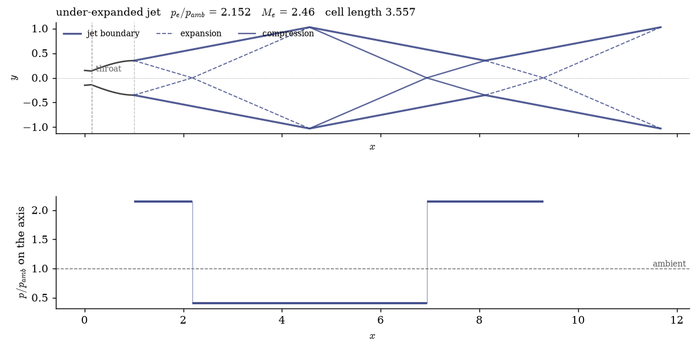
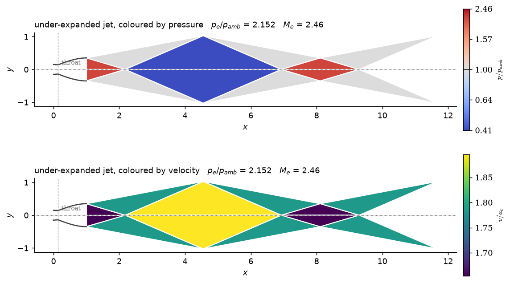
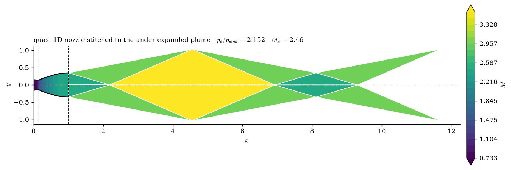

# External flow

Evaluate the lip wave and idealized jet cells from a converged nozzle result. The external model is postprocessing and does not alter the interior solve.

## 4. What happens outside the nozzle

The mesh stops at the lip, but the interesting waves do not. A nozzle designed to
be shock free inside puts its whole wave system *outside*, and
[`src/external/`](../../src/external) evaluates that in closed form from the converged
exit state. It is deliberately separate from the solver: nothing in a flow solve
calls it, so post-processing that can legitimately have no answer fails where you
asked for it rather than inside a march.

```bash
./dg2d.sh run external       # examples/07_external.py
```

```python
from src.api import solve_nozzle
from src.external import exit_wave_structure, jet_wave_cells, plot_jet_cells

r = solve_nozzle(order=2, refine=0, back_pressure_ratio=0.0640)

print(exit_wave_structure(r, ambient_pressure_ratio=0.03).describe())
# under-expanded: p_e/p_amb = 2.1517, M_e = 2.458 -> 2.957,
# Prandtl-Meyer fan from 24.01 to 8.98 deg, turning the flow 10.79 deg outward

cells = jet_wave_cells(r, ambient_pressure_ratio=0.03, cells=3)
print(cells.describe())
# under-expanded jet: 6 waves, cell length 3.5574 (10.16 exit half-heights),
# reaching x = 11.6723 ...

plot_jet_cells(r, cells)
```

`exit_wave_structure` gives the first wave at the lip. `jet_wave_cells` extends
the domain downstream, marching that wave through its reflections off the
symmetry axis and the constant-pressure jet boundary to give the repeating
shock-cell pattern — the "shock diamonds" of a rocket plume. The domain reaches
roughly ten nozzle lengths at a strong under-expansion, and the cell length is a
real number you can compare against a photograph.



`plot_jet_field` colours the regions instead of drawing the waves, which is what
makes the ringing read as alternating states rather than as a line drawing. The
two quantities are encoded differently on purpose: pressure is a *polarity* —
which side of ambient a region sits on — so it gets a diverging ramp pinned at
`p_amb`, on `log(p/p_amb)` so that twice ambient and half ambient are equal and
opposite departures. Velocity is a magnitude with no special middle value, so it
gets viridis — perceptually uniform, monotone in lightness, and readable under
every common colour-vision deficiency. Pass `cmap=` to override either.



**The nozzle and the plume as one field.** `plot_nozzle_and_plume` draws the
quasi-1D solution *inside* the nozzle and the wave-cell march *outside* on one
axis and one colour scale:

Continue in the same Python session:

```python
from src.external import plot_nozzle_and_plume

plot_nozzle_and_plume(r, quantity="mach", ambient_pressure_ratio=0.03)
```



Everything plotted is a ratio — `M`, `p/p_t`, `T/T_t`, `v/a_t` — because the two
regions report in different units, and stitching raw values would join two
scales and look seamless while being wrong.

**Pressure alone is drawn on a log ramp**, and the colourbar says so. Across the
nozzle *and* the plume, `p/p_t` runs from about 1 at the reservoir to 0.01 in the
expanded jet — more than a decade and a half. On a linear ramp the whole exterior
collapses into the bottom colour step and the shock-cell structure, which is the
subject of the figure, vanishes. `M`, `T/T_t` and `v/a_t` each span well under a
factor of five, so they stay linear, where a colour difference can be read as
proportional to a difference in the quantity.

**The small step at the dashed exit line is real, and it is the point.** Inside
is quasi-1D theory; outside is a march started from the *computed* exit state,
which is a 2D solve. Quasi-1D assumes parallel streamlines at the exit and the
real flow is still diverging, so the two disagree by roughly 0.3–1%. That step
is the two-dimensionality of the exit flow — the same effect that puts this
nozzle's true design point at `p_b/p_t ≈ 0.0669` rather than the quasi-1D
`0.0640`. Drawing both sides from one model would hide it, which is why the
test pins the step as *non-zero* as well as small.

For the 2D solution against quasi-1D **inside** the nozzle, see
[`plot_dg_vs_quasi1d`](postprocessing.md#plotting).

Two things to know before reading numbers off it. **Every wave is treated as
isentropic**, which is what makes the pattern exactly periodic; a real jet's
compressions steepen into shocks, lose total pressure, and the cells decay
downstream. And a strongly mismatched jet forms a **Mach disc** rather than the
regular reflection assumed here — the march detects that and stops rather than
drawing a pattern that does not exist.
