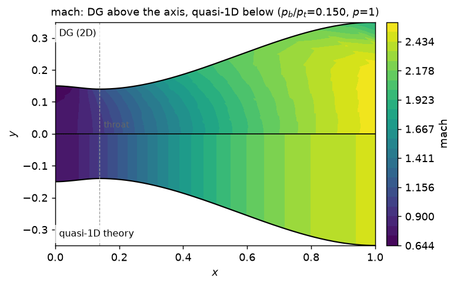

# Postprocessing

Draw fields and extract profiles from a converged nozzle result. Compare like nondimensional quantities on a shared scale.

## Plotting

```python
import matplotlib.pyplot as plt
from src import solve_nozzle

result = solve_nozzle(contour="smooth", verbose=False)
assert result.converged, result.message

from src.post.plotting import overview, plot_centreline, plot_field

overview(result)  # four-panel summary; its top panel is the Mach contour
plt.show()
```

**Contours of any derived scalar.** `plot_field` fills contours over the
nozzle, mirrored about the axis so you see the physical channel rather than the
meshed half. Mach is the default because it is the field you read a nozzle by:

Continue with the `result` created above:

Continue in the same Python session:

```python
plot_field(result, "mach")  # the default
plot_field(result, "temperature")
plot_field(result, "pressure")
```

| `name=` | Quantity |
|---|---|
| `mach` *(default)* | Mach number |
| `pressure` | static pressure |
| `density` | density |
| `temperature` | static temperature, `p/(R rho)` |
| `vx`, `vy`, `velocity` | axial, transverse and total speed |
| `entropy` | `(p/rho^gamma)` over its reservoir value |

Each element is subdivided `subdivisions` times per edge, so the variation
*inside* an element is drawn — plotting only the vertices would throw away most
of what `p = 2` buys.

**Axial profiles against quasi-1D theory.** `plot_centreline` draws the DG
solution along the symmetry axis with the quasi-1D prediction over it. The gap
between the two curves *is* the two-dimensionality of the flow:

Continue with the `result` created above:

Continue in the same Python session:

```python
plot_centreline(result)  # Mach number, the default
plot_centreline(result, quantity="temperature")
```

`quantity` is one of `mach`, `pressure`, `density`, `temperature`, `vx` or
`velocity`; anything else is refused by name rather than failing inside
Matplotlib.

**The 2D solution and quasi-1D theory in one picture**, inside the nozzle.
`plot_dg_vs_quasi1d` puts
the DG field above the axis and the quasi-1D prediction for the same geometry
below it, on one shared colour scale:

Continue in the same Python session:

```python
from src.post.plotting import plot_dg_vs_quasi1d

plot_dg_vs_quasi1d(result, "mach")
plot_dg_vs_quasi1d(result, "temperature")
```



Because the nozzle is symmetric, the lower half is *where the mirror image of
the DG solution would have gone* — so **contours that fail to meet at the axis
are the two-dimensionality of the flow**, read off at a glance instead of
inferred from two separate plots. Quasi-1D has no transverse coordinate, so its
half is flat in `y` at each station: seeing it flat is seeing the assumption.

The shared colour scale is the point. Giving each half its own would make even
a large disagreement look like agreement. Quantities quasi-1D does not predict
(`vy`, `entropy`) are refused rather than drawn against an implicit zero.

**Line-outs as arrays**, if you would rather have the numbers than a picture —
each returns a dict of `x`, `y` and every scalar above:

Continue in the same Python session:

```python
from src.post.postprocess import centreline_profile, exit_profile, wall_profile

cl = centreline_profile(result)
print(cl["temperature"].min(), cl["mach"].max())
```
