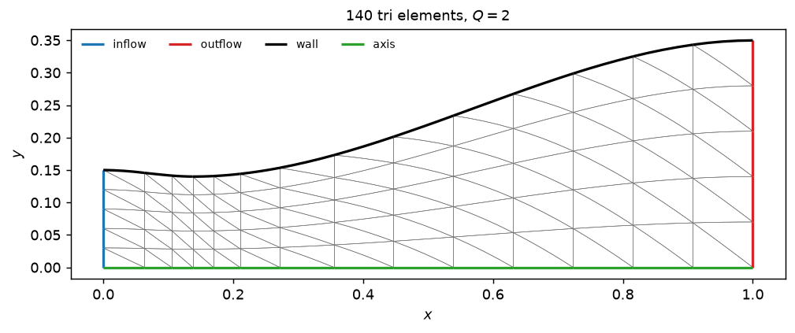

# Solving a case

Choose a geometry, operating point and resolution, then check the returned convergence status. A finished process does not imply every study point converged.

## Choosing resolution

| Knob | Meaning |
|---|---|
| `order` (`p`) | solution polynomial order. `0` is finite volume; `1` and `2` are 2nd and 3rd order. |
| `geometry_order` (`Q`) | `1` straight-sided, `2` curved. `Q=2` represents the curved wall ~125× more accurately at the same element count. |
| `refine` | uniform refinement; each level multiplies elements by 4. |
| `element` | `'tri'` (default) or `'quad'`. |
| `cfl` | Courant number, `cfl/(2p+1)` times the geometric step. The default is order-dependent — see [the time step](../method/time-stepping.md). |

Solve times on 4 cores of a 2.1 GHz Xeon, default `bell` contour, converged to
`1e-6` on the scaled residual, with the Numba kernels already compiled:

| `p` | `refine` | elements | DOF | iterations | time | ms/iteration |
|---|---|---|---|---|---|---|
| 0 | 0 | 140 | 140 | 751 | **0.08 s** | 0.11 |
| 1 | 0 | 140 | 420 | 951 | **0.16 s** | 0.17 |
| 2 | 0 | 140 | 840 | 1901 | **0.46 s** | 0.24 |
| 1 | 1 | 560 | 1680 | 1401 | **0.43 s** | 0.31 |
| 2 | 1 | 560 | 3360 | 3601 | **2.3 s** | 0.64 |
| 1 | 2 | 2240 | 6720 | 3301 | **2.9 s** | 0.86 |

That is 2.5–3.8× faster than this table read a release ago; [what changed and
what each part was worth](../method/backends.md#what-made-it-faster) is below.

The *first* solve in a session pays a few seconds of Numba compilation on top,
once, and then caches it.

**Start with `p=1, refine=0`** for design exploration — a fifth of a second, and
already within a few percent on thrust. Move to `p=2, geometry_order=2,
refine=1` for numbers you will put in a report.
