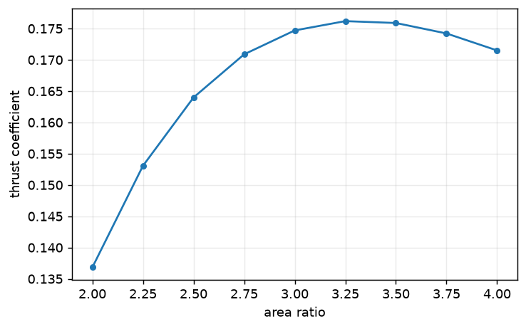

# Parameter sweeps

Solve a sequence of design or operating points and record failures as well as converged results. Reuse a case or warm-start when the API permits it.

## 1. Parameter sweeps

```bash
./dg2d.sh run sweep          # examples/02_sweep.py
```

Or from the command line, with no script at all:

```bash
./dg2d.sh sweep area_ratio 2.0 4.0 9 order=1 refine=1 contour=smooth csv=sweep.csv
```

In Python:

```python
import numpy as np
from src import sweep

table = sweep(
    area_ratio=np.linspace(2.0, 4.0, 9),  # iterable  -> a sweep axis
    order=1,
    refine=1,
    contour="smooth",  # scalar    -> a fixed setting
)
print(table.table())
table.to_csv("sweep.csv")
```



Thrust **peaks and then falls** — past the matched condition the nozzle
over-expands and the extra area costs more than the extra exit Mach number buys.
On this sweep the optimum is at `area_ratio = 3.25` (`c_F = 0.176`), and thrust
efficiency drops from 0.956 to 0.869 across the range. That trade is the point of
Exercise 1 in the lab guide.

Sweeps **warm start** from the previous point automatically. Measured on a
7-point area-ratio sweep that is 40% fewer iterations and 1.8× less wall time.
Two parameters give a full grid:

Continue in the same Python session:

```python
grid = sweep(
    area_ratio=np.linspace(2.0, 4.0, 7),
    back_pressure_ratio=np.linspace(0.08, 0.40, 6),
    order=1,
)
from src.post.plotting import plot_sweep

plot_sweep(grid, "thrust_coefficient")  # 2D contour map
```

Every point records 19 metrics (`src.METRICS`), including the quasi-1D
reference values so you can see where two-dimensionality starts to matter.
Points that fail are recorded, not hidden:

Continue in the same Python session:

```python
for point, why in table.failures():
    print(point, "→", why)
```
