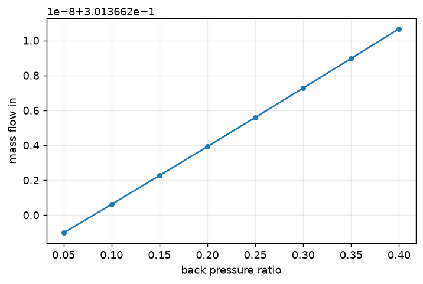

# Quasi-1D and conservation comparisons

Exit state, choked flow, mass balance and thrust-form comparisons with measured errors.

## Choking, as a check on the solver



Once the nozzle is choked, mass flow must not depend on back pressure at all.
Across the whole shock-free range the computed spread is **2.1e-8** — a check the
solver was never tuned to pass, and a good one to have students reproduce.

## Conservation and reference-state checks

`tests/test_solver.py` compares the converged smooth nozzle against `src.physics.quasi1d.solve_quasi1d`. Tests require inlet/outlet mass imbalance below 0.005, thrust-form imbalance below 0.02, exit Mach within 3%, mass flow within 2%, and exit pressure within 5% of the quasi-1D reference. These are test tolerances, not asserted digits of exact physical agreement.

```bash
# Run converged solves, conservation checks and quasi-1D comparisons.
./dg2d.sh test tests/test_solver.py
```

The [quick start](../getting-started/quick-start.md) gives a captured operating point. The [nozzle-flow derivation](../theory/nozzle-flow.md) defines the reference relations.
